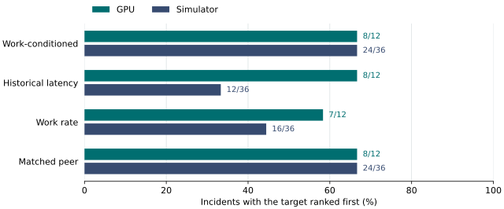
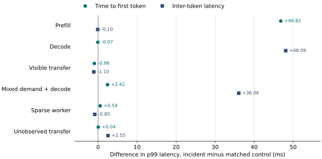

# Experimental Evaluation and Results

**Passive Fail Slow Diagnosis in Disaggregated LLM Inference**

IIT Hyderabad · CS5903 · Project 25 · Group 5

On four SageMaker GPUs serving Qwen, the work-conditioned detector ranked the injected component first in **8 of 12 incidents** and abstained in four. Historical latency matched its accuracy and median delay. Matched peer localized the same eight incidents, took 20 seconds longer at the median, and recorded zero false episodes during the observed healthy traffic. The conditioned detector recorded three. The results support localization of observable slowdowns under this workload. They also identify false alarms and incomplete telemetry as limits on deployment. [GPU incident records][incidents] · [GPU method summary][gsummary]

Sections 3–5 of the executed [SageMaker_vLLM.ipynb](../DAT_CS5903_Final/DAT-CS5903/SageMaker_vLLM.ipynb) contain the pilot receipts, the four-method comparison and the per-incident results reported here. The saved outputs can be reviewed directly on GitHub.

## Experimental design

| Experiment | Workload and controls | Question |
|---|---|---|
| Four-GPU vLLM study | Qwen2.5-0.5B-Instruct, vLLM 0.10.2, FP16, four A10Gs on one host, two workers per stage, batch size one. Seed 41201, nominal 2.6 requests/s, 40 trials of 90 s. | Can measured serving traces localize a known slowdown while token output remains correct? |
| Repeated simulator study | Same six incident types and two severities, three repetitions each. Of 96 trials of 180 s, 12 fit or calibrate the models, 36 contain incidents, 36 are matched controls and 12 are additional held-out trials. | How does localization change across repeated incidents and healthy traffic? |
| Correctness and robustness tests | Four native GPU handoff routes, separate CPU Qwen fault/control trials, and automated tests for timing, request correlation, leakage and missing evidence. | Can the measurements and decisions be reproduced from the recorded inputs? |

The GPU experiment used 12 healthy trials for fitting, scaling and threshold selection (four each). The remaining 28 comprised 12 incidents, their 12 matched no-fault controls and four additional healthy trials. At both 1.5× and 3× severity, the harness added a wait proportional to the targeted worker or copy operation. All 12 interventions affected at least one operation. Only the offline evaluator used the target labels. Of 10,209 offered requests, 10,208 were accepted and 10,198 completed within the observation horizon. The remaining ten accepted requests were right-censored. [GPU manifest][gmanifest] · [Simulator manifest][smanifest] · [Verification output][verify]

### Metrics and baselines

- **First-rank accuracy** counts incidents whose first nonempty ranking places the injected component first, divided by all injected incidents. An abstention and an incorrect first choice each count as a miss.
- **Time to correct diagnosis** is the time from fault onset to the first tick that ranks the target first. The median includes only incidents that eventually reach a correct top rank. An incorrect first ranking can later contribute a valid delay.
- **False episodes per hour** divides the number of transitions into a nonempty ranking during no-fault trials by monitored healthy cluster-hours. A continuous alarm counts once. Each 90 s GPU trial contributes 60 monitored seconds after the first 30 s window.
- **Paired latency impact** subtracts a matched control's p99 client latency from the incident trial's p99. Time to first token (TTFT) and inter-token latency (ITL) measure different parts of the request. **Explanation accuracy** counts correct labels among eligible, stable windows with a client latency alarm.

The submitted method scores duration above the healthy upper quantile for comparable work. Historical latency uses past duration, work rate scales duration by units of work, and matched peer compares contemporaneous residuals across workers of the same stage with comparable work. All four methods use the same held-out trials and separate healthy thresholds. [Metric and baseline equations][math]

## GPU localization and baseline comparisons

| Method | First correct / 12 | Abstained | Wrong first | Median correct delay | False episodes / 16 min | Episodes/h (95% Poisson interval) |
|---|---:|---:|---:|---:|---:|---:|
| Work-conditioned | 8 (66.7%) | 4 | 0 | 12.5 s | 3 | 11.25 (2.32–32.88) |
| Historical latency | 8 (66.7%) | 4 | 0 | 12.5 s | 4 | 15.00 (4.09–38.41) |
| Work rate | 7 (58.3%) | 3 | 2 | 17.5 s | 2 | 7.50 (0.91–27.09) |
| Matched peer | 8 (66.7%) | 4 | 0 | 32.5 s | 0 | 0.00 (0.00–13.83) |

Each median above uses eight incidents. One initially incorrect work-rate ranking later corrected. The conditioned detector exceeded the target of one false episode per hour. Zero episodes in 16 minutes also leaves considerable uncertainty for matched peer. The intervals are illustrative because scoring windows overlap and healthy exposure is short. [Healthy-run episode counts][healthy] · [Method summary][gsummary]



**Figure 1.** Work conditioning tied historical latency on the GPU and localized 12 more incidents than historical latency in simulation. Matched peer tied work conditioning on first-rank accuracy in both studies. Each bar uses all incidents in its own study, including abstentions. [GPU results][gsummary] · [Simulator results][ssummary]

### Which incidents could the detector localize?

| GPU test case | Target | 1.5× result | 3× result | Observation |
|---|---|---|---|---|
| Prefill slowdown | p1 | p1 at 12.5 s | p1 at 12.5 s | The first ranking identified the prefill worker. |
| Decode slowdown | d1 | d1 at 12.5 s | d1 at 12.5 s | Decode latency increased even though matched generations agreed. |
| Visible cache transfer | l11 | l11 at 22.5 s | l11 at 22.5 s | Both transfers took one additional 10 s scoring tick to localize. |
| Demand shift and slow decode | d1 | d1 at 12.5 s | d1 at 12.5 s | The target ranking was correct at both severities. The eligible mixed window received an incomplete explanation. |
| Sparse prefill worker | p2 | Abstained | Abstained | Too few supported requests traversed the affected worker. |
| Unobserved transfer | l11 | Abstained | Abstained | The affected path lacked transfer timings. |

Times are relative to intervention onset. The monitor requires at least five supported requests, at least 80% supported observations and two successive threshold crossings. The four abstentions remained in the denominator. [Per-incident rankings and delay][incidents]

## Client impact and a measured diagnosis



**Figure 2.** Each point compares one incident with its own matched control. At 3× slowdown, prefill raised p99 TTFT by **46.82 ms** and decode raised p99 ITL by **48.09 ms**. In the visible-transfer trial the detector still ranked the path first, while both client p99 differences were slightly negative. Component localization and client impact answer different questions. Completed throughput matched within each of the 12 pairs. One repetition per GPU case and severity limits inference from the individual differences. [Paired service impacts][pairs] · [Per-trial client metrics][service]

In the 3× decode trial, a measured forward took 46.95 ms against an adjusted healthy upper bound of 15.43 ms. The operation's normalized excess was 13.91. At 40 s, the aggregate score for d1 was 49.38 across 31 supported requests, above the frozen threshold of 3.27. At 50 s the score reached 247.02 across 35 requests. This second crossing triggered the first ranking, **12.5 s after onset at 37.5 s**. The matched control stayed below threshold, and both arms returned the same 206 generated sequences. Their p99 ITLs were 90.65 ms and 42.56 ms, respectively. [Worked derivation][math] · [CPU replay script][example]

Only three stable GPU windows met the client-alarm and explanation criteria. The detector correctly labeled decode degradation, labeled the mixed case as degradation alone, and returned unknown for the workload-only case. This yields **1/3** correct explanations. In simulation, it explained **142/217 (65.4%)** eligible windows correctly. Window counts and incident counts describe different outcomes. [GPU window labels][explain] · [Simulator window labels][sexplain]

## Repeated simulation and correctness checks

| Simulator method | First correct / 36 | Abstained | Wrong first | Median time to correct top rank | False episodes / 2 healthy hours |
|---|---:|---:|---:|---:|---:|
| Work-conditioned | 24 | 12 | 0 | 15 s (24 incidents) | 6 |
| Historical latency | 12 | 24 | 0 | 25 s (12 incidents) | 3 |
| Work rate | 16 | 17 | 3 | 25 s (17 incidents) | 11 |
| Matched peer | 24 | 12 | 0 | 25 s (24 incidents) | 1 |

At each severity, work conditioning localized all three repeats of prefill, decode, visible transfer and mixed incidents. It abstained in all 12 sparse or unobserved-path incidents across both severities. Its six false episodes in two healthy hours also exceeded the 1/h objective. [Simulator incident records][sincidents] · [Simulator summary][ssummary]

| Test or acceptance case | Observed evidence |
|---|---|
| KV handoff across four GPU routes | All routes loaded 128 cached tokens and reproduced all eight greedy output token IDs from unsplit execution. File-copy times ranged from 3.652 to 3.700 ms. [Pilot measurements][pilot] |
| Identical work and output under intervention | All 2,821 common completed requests across the 12 fault/control pairs matched on prompt hash and output token IDs. [Pair inventory][generation] |
| Live decisions versus offline replay | All 784 rankings and explanations agreed across 28 held-out trials, seven ticks and four methods. [GPU verifier][gpucheck] |
| Single-engine Qwen CPU check | 240 requests, 934 forward records, 64 matched outputs and 520 decisions. The decode case initially ranked prefill, then correctly ranked decode. Both controls had one false episode. [CPU results][cpu] · [Frozen acceptance check][accept] |
| Time ordering, missing observations and input validity | All 11 automated tests passed. They exercise future-data exclusion, unknown configurations, missing peers, invalid streams and duplicate or unmatched records. [Pipeline tests][tests] · [Serving tests][native] · [Recorded test output][testlog] |

**Scope.** The GPU deployment used one host, file-backed KV transfers, batch size one and one repetition per case and severity. GPU monitoring overhead remains unmeasured against the 5% target. Independent GPU repetitions, longer healthy observation, paired overhead runs and inter-host measurements are needed to assess reliability under production serving conditions.

## Reproduction

From the repository root, the first two commands use only the Python standard library and the archived traces. They verify the pilot and print the method counts, 40 completed trials, 2,821 matched generations and 784 matching decisions.

```sh
python evaluation/check_gpu_pilot.py
python evaluation/check_gpu_study.py
```

With the project's [CPU dependencies][lock] installed, the following commands regenerate both figures, reproduce the worked diagnosis and run the automated and frozen checks. They require no GPU.

```sh
python evaluation/plot_experimental_results.py
python evaluation/replay_formula_example.py
cd DAT_CS5903_Final/DAT-CS5903
python -m unittest discover -s tests -v
python evaluation/acceptance.py
```

The evaluation uses frozen run data from [revision e20f537][run]. To collect a new GPU study, follow the [SageMaker runbook][runbook]. A new run can produce different timings.

[incidents]: ../DAT_CS5903_Final/DAT-CS5903/dat-vllm-experiment/study-2x2-r1-t90-q2.6/incidents.csv
[gsummary]: ../DAT_CS5903_Final/DAT-CS5903/dat-vllm-experiment/study-2x2-r1-t90-q2.6/summary.csv
[gmanifest]: ../DAT_CS5903_Final/DAT-CS5903/dat-vllm-experiment/study-2x2-r1-t90-q2.6/study.json
[smanifest]: ../DAT_CS5903_Final/DAT-CS5903/results/synthetic/study.json
[verify]: ../evaluation/gpu_study_verification.txt
[math]: Mathematical_Methods.md
[healthy]: ../DAT_CS5903_Final/DAT-CS5903/dat-vllm-experiment/study-2x2-r1-t90-q2.6/healthy_runs.csv
[ssummary]: ../DAT_CS5903_Final/DAT-CS5903/results/synthetic/summary.csv
[pairs]: ../DAT_CS5903_Final/DAT-CS5903/dat-vllm-experiment/study-2x2-r1-t90-q2.6/paired_impact.csv
[service]: ../DAT_CS5903_Final/DAT-CS5903/dat-vllm-experiment/study-2x2-r1-t90-q2.6/service.csv
[example]: ../evaluation/replay_formula_example.py
[explain]: ../DAT_CS5903_Final/DAT-CS5903/dat-vllm-experiment/study-2x2-r1-t90-q2.6/explanations.csv
[sexplain]: ../DAT_CS5903_Final/DAT-CS5903/results/synthetic/explanations.csv
[sincidents]: ../DAT_CS5903_Final/DAT-CS5903/results/synthetic/incidents.csv
[pilot]: ../evaluation/gpu_pilot_routes.csv
[generation]: ../DAT_CS5903_Final/DAT-CS5903/dat-vllm-experiment/study-2x2-r1-t90-q2.6/generation_pairs.csv
[gpucheck]: ../evaluation/check_gpu_study.py
[cpu]: ../DAT_CS5903_Final/DAT-CS5903/results/qwen-vllm-cpu/summary.csv
[accept]: ../DAT_CS5903_Final/DAT-CS5903/evaluation/acceptance.py
[tests]: ../DAT_CS5903_Final/DAT-CS5903/tests/test_pipeline.py
[native]: ../DAT_CS5903_Final/DAT-CS5903/tests/test_native_server.py
[testlog]: ../evaluation/verification.log
[lock]: ../DAT_CS5903_Final/DAT-CS5903/locks/cpu-py312-linux.txt
[run]: https://github.com/sid15022/DAT-CS5903/commit/e20f53712de648b8c03784d2b1c8496146fc2d16
[runbook]: ../DAT_CS5903_Final/DAT-CS5903/README.md
